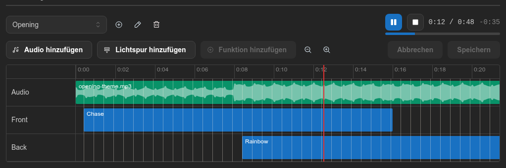
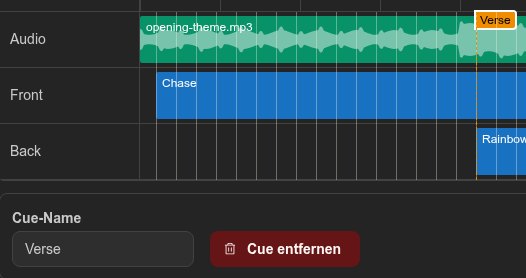
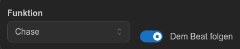

# Show-Manager

Im Tab **Show-Manager** bauen Sie zeitgesteuerte Lichtshows zur Musik. Eine Show ist eine Zeitleiste mit einer Audiospur und beliebig vielen Lichtspuren. Auf die Audiospur legen Sie Audiodateien, auf die Lichtspuren Funktionen. Die App findet die Beats in der Musik, zeichnet sie als senkrechte Linien und kann Ihre Funktionen auf jedem Beat einen Schritt weiterschalten.

## Inhalt

- [Audioausgang einrichten](#audioausgang-einrichten)
- [Show anlegen](#show-anlegen)
- [Audiospur](#audiospur)
  - [Beat-Linien](#beat-linien)
  - [Cues](#cues)
- [Lichtspuren](#lichtspuren)
  - [Clip-Einstellungen](#clip-einstellungen)
  - [Überlappende Clips](#überlappende-clips)
- [Show abspielen](#show-abspielen)
- [Einschränkungen](#einschränkungen)

## Audioausgang einrichten

Der Server spielt die Musik ab, nicht der Browser. Wählen Sie, wohin sie geht:

1. Öffnen Sie den Tab **Ein-/Ausgabe**.
2. Setzen Sie unter **Audioausgang** das Häkchen **Verwenden** bei der Soundkarte oder dem Lautsprecher.

Ein Projekt hat einen Audioausgang; wählen Sie einen anderen, ersetzt er den bisherigen. Ohne Audioausgang spielt eine Show trotzdem ihr Licht ab, dann nach der Uhr statt nach der Musik.

## Show anlegen

1. Öffnen Sie den Tab **Show-Manager** und klicken Sie auf **Neue Show**.
2. Geben Sie einen **Name** ein und klicken Sie auf **Speichern**.

Mit der Liste oben links wechseln Sie zwischen den Shows. Die Symbole daneben legen Shows an, benennen sie um und löschen sie. Beim Löschen einer Show wird auch ihr Audio gelöscht.

## Audiospur

Klicken Sie auf **Audio hinzufügen** und wählen Sie eine Datei. Unterstützt werden MP3-, WAV-, FLAC-, Ogg- (Vorbis) und Opus-Dateien bis 200 MB und eine Stunde Länge. Der Server wandelt die Datei einmal um und analysiert sie; bei langen Dateien kann das einige Sekunden dauern. Neues Audio kommt direkt hinter den letzten Audio-Clip.

- Ziehen Sie einen Audio-Clip, um ihn zu verschieben. Clips auf der Audiospur dürfen aneinanderstoßen, sich aber nicht überlappen; **Speichern** lehnt überlappende Clips ab.
- Klicken Sie einen Audio-Clip an und dann auf **Audio entfernen**, um ihn zu löschen.
- **Audio hinzufügen** und **Audio entfernen** gehen nur ohne ungespeicherte Änderungen: Speichern oder verwerfen Sie zuerst.

### Beat-Linien

Die senkrechten Linien auf der Zeitleiste sind die Beats, die der Server im Audio gefunden hat. Er nutzt dieselbe Beat-Erkennung wie das Steuerelement [Audio-Trigger](../virtual-console/audio-trigger.md): Einsätze von Kick und Bass zwischen 40 und 150 Hz. Die Linien wandern mit ihrem Audio-Clip. Der erste Beat wird erst nach 0,3 s Audio erkannt; ein Kick ganz am Anfang einer Datei hat daher keine Linie.

### Cues

Cues markieren Stellen der Show, zu denen Sie springen wollen, etwa den Refrain oder einen Drop.

1. Setzen Sie den roten Abspielkopf an die Stelle und klicken Sie auf **Cue hinzufügen**. Der Cue rastet an einer nahen Beat-Linie ein und heißt **Cue 1**, **Cue 2** und so weiter.
2. Klicken Sie auf die gelbe Fahne eines Cues auf der Audiospur, um dorthin zu springen; läuft die Show, spielt sie ab dem Cue weiter. Ziehen Sie die Fahne, um den Cue zu verschieben; er rastet an einer nahen Beat-Linie ein.
3. Ändern Sie den **Cue-Name** oder klicken Sie auf **Cue entfernen**; auch die Entf-Taste entfernt den ausgewählten Cue.
4. Klicken Sie auf **Speichern**.

Cues gehören zur Show, nicht zu einem Audio-Clip: Verschieben oder Entfernen von Audio lässt sie, wo sie sind. Sie ändern weder die Länge der Show noch, was sie abspielt. Das Steuerelement [Show](../virtual-console/show-control.md) zeigt sie auf seiner Zeitleiste und als Schaltflächen zum Springen.

## Lichtspuren

1. Klicken Sie auf **Lichtspur hinzufügen**. Klicken Sie auf einen Spurnamen, um die Spur auszuwählen.
2. Klicken Sie auf **Funktion hinzufügen**: Auf der ausgewählten Spur erscheint am roten Abspielkopf ein Clip von 8 s mit der ersten Funktion des Projekts.
3. Ziehen Sie einen Clip, um ihn zu verschieben, auch auf eine andere Lichtspur, und ziehen Sie seinen rechten Rand, um ihn länger oder kürzer zu machen. Clip-Ränder rasten an einer nahen Beat-Linie ein.
4. Klicken Sie auf **Speichern**.

Klicken Sie ohne ausgewählten Clip auf einen Spurnamen, um die Spur umzubenennen (**Spurname**) oder zu löschen (**Spur entfernen**). Mit den Lupen-Symbolen oder dem Mausrad über der Zeitleiste vergrößern und verkleinern Sie sie; beim Mausrad bleibt die Stelle unter dem Mauszeiger, wo sie ist. Halten Sie Umschalt gedrückt, um mit dem Mausrad seitwärts zu blättern.

### Clip-Einstellungen

Klicken Sie einen Clip an, um ihn zu ändern:

- **Funktion**: die Funktion, die der Clip abspielt.
- **Dem Beat folgen** (bei neuen Clips an): Die Funktion startet dunkel und geht auf jedem Beat innerhalb des Clips einen Schritt weiter. Aus: Die Funktion läuft ab dem Anfang des Clips mit ihrem eigenen Timing.
- **Clip entfernen** oder die Entf-Taste löscht den Clip.

### Überlappende Clips

Clips auf verschiedenen Spuren dürfen sich überlappen.

- Clips verschiedener Funktionen spielen gleichzeitig; nutzen sie denselben Kanal, gewinnt der höchste Wert.
- Clips derselben Funktion teilen sich eine laufende Funktion: Sie läuft, solange einer von ihnen unter dem Abspielkopf liegt, und folgt dem Beat, wenn einer von ihnen das tut.
- Zwei Clips derselben Funktion direkt hintereinander starten die Funktion beim zweiten Clip neu.

## Show abspielen

Nutzen Sie **Abspielen**, **Pause** und **Stopp** oben rechts. Die Zeiten zeigen vergangene, gesamte und verbleibende Zeit.

- Ziehen Sie die rote Markierung oder klicken bzw. ziehen Sie irgendwo auf dem Zeitlineal, um vor- und zurückzuspulen. Läuft die Show, springt sie beim Loslassen dorthin. Ist sie pausiert oder gestoppt, legt die Markierung fest, wo **Abspielen** beginnt.
- **Pause** hält Musik und Funktionen der Show an und behält die Position; **Abspielen** macht dort weiter.
- Am Ende der Show oder bei **Stopp** werden die Funktionen der Show beendet.
- Der Server spielt die gespeicherte Show. Ungespeicherte Änderungen werden erst nach **Speichern** abgespielt.
- Es läuft immer nur eine Show. Starten Sie eine andere, wird die laufende beendet.
- Läuft eine Funktion schon, wenn ihr Clip beginnt, etwa über eine Konsolentaste, bleibt sie der Konsole überlassen: Die Show startet sie weder neu noch beendet sie sie.
- Ein [Globaler Tap](../virtual-console/global-tap.md) schaltet auch die Funktionen weiter, die eine Show abspielt.

Um eine Show aus der virtuellen Konsole zu starten, nutzen Sie das Steuerelement [Show](../virtual-console/show-control.md).

## Einschränkungen

- Shows sind nicht Teil von Projekt-Export und -Import.
- Musik und Licht können um die Verzögerung der Soundkarte auseinanderliegen; es gibt keine Einstellung, um sie auszugleichen.
- Audio-Clips können sich nicht überlappen und werden daher nie gemischt.
- Änderungen an einer laufenden Show gelten erst beim nächsten Start.
- Die Clips auf der Zeitleiste lassen sich nur mit Maus oder Touch verschieben und in der Länge ändern, nicht mit der Tastatur.
