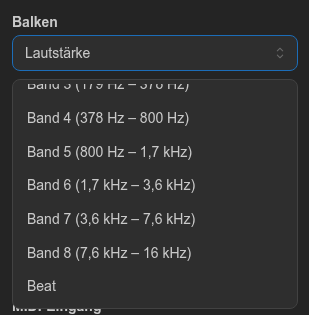
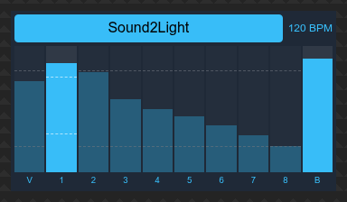
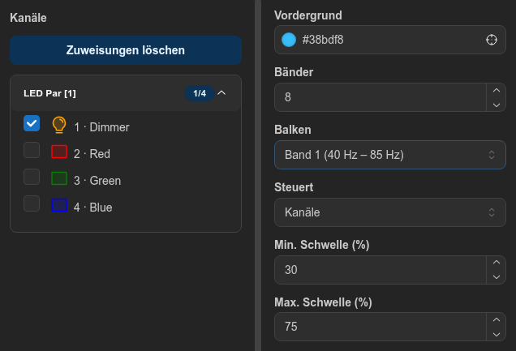
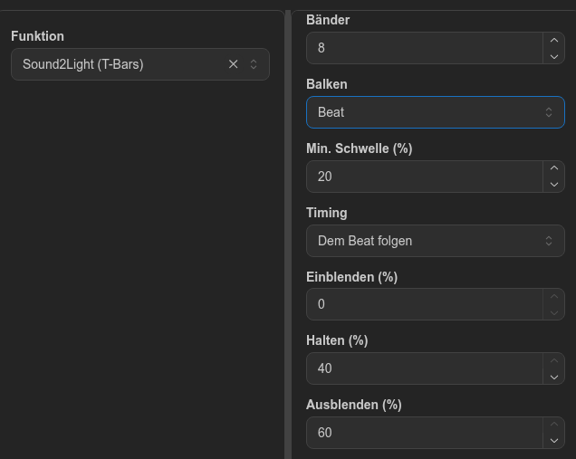

# Audio-Trigger

Mit dem Steuerelement **Audio-Trigger** reagiert Ihr Licht auf Ton. Es misst das Eingangssignal als einen Balken **Lautstärke** und bis zu 16 Frequenzbänder. Jeder Balken kann eine von zwei Aufgaben übernehmen:

- den Pegel von DMX-Kanälen setzen, zum Beispiel für einen Dimmer, der dem Bass folgt
- eine Funktion starten und stoppen, zum Beispiel eine Sequenz, die bei lauten Passagen läuft

Ein eigener Balken **Beat** erkennt die Bassdrum und schaltet eine Sequenz bei jedem Beat einen Schritt weiter. So bleibt das Licht im Takt der Musik.

Die Klanganalyse läuft auf dem Server. Das Licht reagiert also weiter, wenn Sie das Browserfenster schließen.

## Inhalt

- [Bevor Sie beginnen](#bevor-sie-beginnen)
- [Steuerelement hinzufügen und einrichten](#steuerelement-hinzufügen-und-einrichten)
- [Einschalten](#einschalten)
  - [Die Anzeige lesen](#die-anzeige-lesen)
- [So funktionieren die Schwellen](#so-funktionieren-die-schwellen)
  - [Kanäle](#kanäle)
  - [Funktion](#funktion)
  - [Was die Prozentwerte bedeuten](#was-die-prozentwerte-bedeuten)
- [Beat](#beat)
  - [Was als Beat zählt](#was-als-beat-zählt)
  - [So läuft die Sequenz ab](#so-läuft-die-sequenz-ab)
  - [Timing](#timing)
- [Beispiel: Bass auf den Dimmer, Sequenz bei lauten Passagen](#beispiel-bass-auf-den-dimmer-sequenz-bei-lauten-passagen)
- [Beispiel: ein Lauflicht auf jede Bassdrum](#beispiel-ein-lauflicht-auf-jede-bassdrum)
- [Frequenzbereich](#frequenzbereich)
  - [Was außerhalb der Grenzen liegt](#was-außerhalb-der-grenzen-liegt)
  - [So werden die Bänder aufgeteilt](#so-werden-die-bänder-aufgeteilt)
  - [Anzahl der Bänder wählen](#anzahl-der-bänder-wählen)
- [Fehlerbehebung](#fehlerbehebung)
- [Einschränkungen](#einschränkungen)

## Bevor Sie beginnen

Das Steuerelement braucht einen Audioeingang im Projekt:

1. Öffnen Sie im Projekt den Tab **Ein-/Ausgabe**.
2. Aktivieren Sie unter **Audioeingang** bei Ihrem Gerät **Verwenden**. Ein Projekt kann einen Audioeingang verwenden.
3. Wählen Sie **Mono** oder **Stereo**. Bei einem Stereoeingang werden beide Kanäle für die Analyse zusammengemischt.
4. Spielen Sie Musik ab und prüfen Sie, ob sich die Pegelanzeige bewegt.

## Steuerelement hinzufügen und einrichten

1. Öffnen Sie den Tab **Virtuelle Konsole**.
2. Ziehen Sie **Audio-Trigger** aus **Steuerelement hinzufügen** auf die Arbeitsfläche und klicken Sie es an, um es auszuwählen.
3. Stellen Sie unter **Bänder** die gewünschte Anzahl Frequenzbänder ein (1 bis 16, Standard 8).
4. Wählen Sie unter **Balken** einen Balken aus. Die Liste zeigt **Lautstärke**, jedes Band mit seinem Frequenzbereich und am Ende **Beat**. **Beat** funktioniert anders, siehe [Beat](#beat).
5. Legen Sie unter **Steuert** fest, was der Balken steuert:
   - **Nichts:** Der Balken zeigt nur seinen Pegel an.
   - **Kanäle:** Wählen Sie die Fixture-Kanäle in dem Panel aus, das sich neben der Konsole öffnet.
   - **Funktion:** Wählen Sie die Funktion im selben Panel aus.
6. Stellen Sie für diesen Balken **Min. Schwelle (%)** und **Max. Schwelle (%)** ein (Standard 20 und 80).
7. Wiederholen Sie die Schritte 4 bis 6 für jeden Balken, den Sie verwenden möchten, und klicken Sie dann auf **Speichern**.

Das Licht verwendet nur gespeicherte Einstellungen. **Bänder** und die Schwellen werden übernommen, wenn Sie die Eingabetaste drücken oder das Feld verlassen.

> **Anzahl der Bänder ändern:** Die Balken behalten ihre Einstellungen anhand ihrer Nummer, aber die Frequenzbereiche werden neu berechnet. Band 3 kann danach also andere Frequenzen abdecken. Wenn Sie die Anzahl verringern, werden außerdem die Einstellungen der entfernten Bänder gelöscht.

## Einschalten

Das Steuerelement ist **aus**, wenn der Server startet und wenn Sie zu einem anderen Projekt wechseln. So übernimmt der Ton nie ungefragt Ihr Licht.

Zum Schalten haben Sie zwei Möglichkeiten:

- **Ausgekoppeltes Fenster:** Klicken Sie im Panel **Konsole** auf das Symbol **Auskoppeln** und dann auf den Schalter des Steuerelements. Im Editor lässt sich der Schalter nicht anklicken.
- **MIDI:** Wählen Sie unter **MIDI-Eingang** einen Eintrag aus. Dem Controller muss vorher im Tab **Ein-/Ausgabe** ein MIDI-Mapping zugewiesen sein. Hat der Eintrag LED-Feedback, zeigt seine LED an, ob das Steuerelement eingeschaltet ist. Nutzen mehrere Controller dasselbe Mapping, wählen Sie unter **MIDI-Controller** aus, auf welche das Steuerelement reagiert und wo seine LED leuchtet; ohne Auswahl gilt es für alle.

Jeder Druck schaltet zwischen ein und aus um. Beim Ausschalten stoppt alles, was das Steuerelement gestartet hat.

### Die Anzeige lesen

Jeder Balken ist mit **V** für die Lautstärke (Volume) oder mit seiner Bandnummer beschriftet. Die beiden Linien auf einem Balken markieren seine Min- und Max-Schwelle. Der letzte Balken, **B**, springt bei jedem Beat auf voll und fällt dann wieder ab. Die Balken bewegen sich nur, solange das Steuerelement eingeschaltet ist.

Solange das Steuerelement eingeschaltet ist, steht neben dem Schalter das Tempo, zum Beispiel **120 BPM**. Es zeigt **– BPM**, bis zwei Beats gekommen sind, nach einem Break und wenn 2 Sekunden lang kein Beat kam. Wie es gemessen wird, steht unter [Timing](#timing).

Die Pegel werden geglättet: Sie steigen innerhalb von etwa 40 ms an und fallen über etwa 200 ms ab. So folgt das Licht den Schlägen, ohne zu flackern.

## So funktionieren die Schwellen

Die Schwellen wirken unterschiedlich, je nachdem, was der Balken steuert.

### Kanäle

| Balkenpegel          | DMX-Wert                         |
| -------------------- | -------------------------------- |
| Bis zur Min-Schwelle | 0                                |
| Zwischen Min und Max | Steigt gleichmäßig von 0 auf 255 |
| Ab der Max-Schwelle  | 255                              |

Eine höhere Min-Schwelle blendet leisen Ton aus. Eine niedrigere Max-Schwelle erreicht die volle Helligkeit früher. Je näher die beiden Schwellen beieinanderliegen, desto mehr verhält sich das Licht wie ein Schalter.

Setzt ein anderes Steuerelement oder eine laufende Funktion denselben Kanal, gilt der höhere Wert.

### Funktion

- Die Funktion **startet**, wenn der Balken die Max-Schwelle erreicht.
- Sie **stoppt**, wenn der Balken unter die Min-Schwelle fällt.
- Zwischen den beiden Schwellen ändert sich nichts. Der Abstand verhindert, dass die Funktion schnell ein- und ausschaltet. Vergrößern Sie ihn, falls das passiert.

Lief die Funktion bereits, zum Beispiel über einen Button, wird sie vom Balken weder gestartet noch gestoppt.

Verwenden mehrere Balken dieselbe Funktion, startet der erste, der seine Max-Schwelle erreicht, die Funktion. Sie stoppt, sobald alle unter ihre Min-Schwelle gefallen sind.

### Was die Prozentwerte bedeuten

Die Skala ist in Dezibel und nicht linear: 0 % entspricht −60 dB und 100 % entspricht 0 dB, also einem Vollaussteuerungssignal. 50 % bedeuten daher −30 dB und nicht halb so laut. Die Standardschwellen von 20 und 80 % entsprechen −48 dB und −12 dB.

Ein einzelnes Band enthält nur einen Teil des Signals und zeigt deshalb oft weniger als **Lautstärke**. Die Schwellen für Bänder müssen also unter Umständen niedriger sein als die für die Lautstärke.

## Beat

Der Balken **Beat** schaltet eine Sequenz bei jedem Beat um einen Schritt weiter. Wählen Sie unter **Balken** den Eintrag **Beat** und dann die Sequenz im Panel neben der Konsole. Er hat weder **Steuert** noch **Max. Schwelle (%)**, nur **Min. Schwelle (%)** (Standard 20) und **Timing**. Um die Sequenz zu lösen, klicken Sie auf **Funktion entfernen**.

Wenn Sie das Steuerelement einschalten, ist die Sequenz scharfgeschaltet und bleibt bis zum ersten Beat dunkel.

### Was als Beat zählt

- Das Steuerelement hört auf den Bassbereich von 40 bis 150 Hz, in dem die Bassdrum liegt. Hi-Hats, Snares und Gesang zählen nicht.
- Ein Beat ist ein plötzlicher Anstieg in diesem Bereich im Vergleich zu den letzten 1,5 Sekunden. Ein gehaltener Basston löst keine wiederholten Beats aus, und die Erkennung passt sich an laute und leise Songs an.
- Zwischen zwei Beats liegen mindestens 180 ms (etwa 333 BPM). Eine Bassdrum zählt also nie doppelt.
- **Min. Schwelle (%)** ignoriert Beats, deren Basspegel darunter liegt, auf derselben Skala wie die anderen Balken. Erhöhen Sie sie, wenn leise Klänge die Sequenz weiterschalten.

### So läuft die Sequenz ab

- Jeder Beat spielt den nächsten Schritt einmal ab. Wie lange er dauert, hängt von [Timing](#timing) ab.
- Kommt der nächste Beat, bevor der Schritt fertig ist, startet der nächste Schritt sofort und blendet vom aktuellen Zustand aus über.
- Kommen die Beats langsamer als der Schritt, wird ein Schritt mit Ausblenden bis zum nächsten Beat dunkel. Ein Schritt mit Ausblenden 0 hält seinen Zustand.
- **Richtung** und **Ablauf** der Sequenz gelten. Mit **Einmal** stoppt sie nach dem letzten Schritt.
- In der Stille gibt es keine Beats. Das Licht wird also dunkel oder hält seinen letzten Zustand, wie oben beschrieben.
- Beim Ausschalten des Steuerelements stoppt die Sequenz.

Lief die Sequenz beim Einschalten bereits, zum Beispiel über einen Button, behält sie ihr eigenes Tempo und ignoriert die Beats.

> **Verwenden Sie für Beat eine eigene Sequenz.** Nutzen ein Pegelbalken und der Balken Beat dieselbe Sequenz, entscheidet der, der sie zuerst startet, wie sie läuft: Ein Pegelbalken startet sie in ihrem eigenen Tempo, und die Beats werden ignoriert.

### Timing

**Timing** legt fest, wie lange jeder Schritt dauert:

- **Dem Beat folgen** (Standard für neue Steuerelemente): Das Steuerelement misst die Zeit zwischen den Beats und setzt **Einblenden (%)**, **Halten (%)** und **Ausblenden (%)** jedes Schritts als Anteil davon (Standard 0, 40 und 60). Zusammen sind höchstens 100 % möglich, sodass ein Schritt vor dem nächsten Beat endet. Bei 120 BPM, also 500 ms zwischen den Beats, ergeben die Standardwerte 200 ms Halten und 300 ms Ausblenden. Bei 60 BPM sind es 400 ms und 600 ms.
- **Aus der Sequenz**: Jeder Schritt behält das Einblenden, Halten und Ausblenden aus der Sequenz. Steuerelemente, die vor dieser Option gespeichert wurden, verwenden diese Einstellung.

So wird die Zeit zwischen den Beats gemessen:

- Sie ist der mittlere Wert der letzten 4 Abstände zwischen Beats. Eine verpasste Bassdrum ändert sie also nicht. Das Tempo auf dem Steuerelement ist derselbe Wert in BPM.
- Es zählen nur Beats über **Min. Schwelle (%)**.
- Bis zwei Beats gekommen sind und nach einem Break von mehr als 2 Sekunden verwenden die Schritte das Timing der Sequenz.
- Ein geändertes Timing gilt nach dem Speichern ab dem nächsten Beat. Die Sequenz beginnt dabei nicht von vorn.
- Schalten zwei Steuerelemente dieselbe Sequenz weiter, bestimmt das zuerst eingeschaltete das Timing.

## Beispiel: Bass auf den Dimmer, Sequenz bei lauten Passagen

1. Wählen Sie das Steuerelement aus und stellen Sie **Balken** auf das tiefste Band und **Steuert** auf **Kanäle**. Wählen Sie die Dimmer-Kanäle Ihrer Fixtures aus.
2. Achten Sie darauf, dass bei diesen Fixtures auch eine Farbe gesetzt ist, zum Beispiel über einen Slider oder eine andere Funktion. Ein Dimmer allein erzeugt unter Umständen kein Licht.
3. Stellen Sie **Balken** auf **Lautstärke** und **Steuert** auf **Funktion** und wählen Sie eine Sequenz aus.
4. Klicken Sie auf **Speichern**, öffnen Sie das ausgekoppelte Fenster und schalten Sie das Steuerelement ein.
5. Spielen Sie Musik ab und beobachten Sie die Balken. Passen Sie die Schwellen so an, dass der Bass-Balken sie bei jedem Schlag überschreitet und die Lautstärke ihre Max-Schwelle nur bei den lauten Passagen erreicht.

## Beispiel: ein Lauflicht auf jede Bassdrum

1. Erstellen Sie eine Sequenz mit einem anderen Fixture oder einer anderen Farbe in jedem Schritt. Mit **Dem Beat folgen** spielen die Schrittzeiten der Sequenz keine Rolle.
2. Wählen Sie das Steuerelement aus, stellen Sie **Balken** auf **Beat** und wählen Sie die Sequenz aus. Lassen Sie **Timing** auf **Dem Beat folgen**.
3. Klicken Sie auf **Speichern**, öffnen Sie das ausgekoppelte Fenster und schalten Sie das Steuerelement ein.
4. Spielen Sie Musik mit einer deutlichen Bassdrum ab. Jede Bassdrum lässt den nächsten Schritt aufblitzen. Schalten auch leise Klänge weiter, erhöhen Sie **Min. Schwelle (%)**.

Für kürzere Blitze senken Sie **Halten (%)** und **Ausblenden (%)**: Mit 0, 20 und 30 bleibt das Licht in der zweiten Hälfte jedes Beats dunkel. Mit **Aus der Sequenz** halten Sie die Schritte kürzer als die Zeit zwischen zwei Beats (500 ms bei 120 BPM), sonst wirken sie bei schnellen Beats träge.

## Frequenzbereich

Das Steuerelement analysiert den Ton von **40 Hz bis 16 kHz**. Das deckt fast alles ab, worauf es ankommt, wenn Licht der Musik folgen soll, auch wenn es weniger ist als der volle Hörbereich von etwa 20 Hz bis 20 kHz.

Der Balken **Lautstärke** ist nicht nach Frequenzen aufgeteilt: Er folgt dem Gesamtpegel des Eingangssignals.

### Was außerhalb der Grenzen liegt

- **Unter 40 Hz:** vor allem Sub-Bass und Rumpeln. Sehr tiefer Sub-Bass in elektronischer Musik oder Hip-Hop kann bis etwa 30 Hz reichen und im tiefsten Band kaum ankommen. Die Obertöne dieser Noten erscheinen aber in den Bändern darüber.
- **Über 16 kHz:** vor allem „Air“ mit wenig Energie. Verlustbehaftete Formate wie MP3 schneiden diesen Bereich ohnehin oft ab.

### So werden die Bänder aufgeteilt

Der Bereich wird logarithmisch aufgeteilt, sodass jedes Band dasselbe musikalische Intervall abdeckt. Tiefe Bänder sind daher in Hz schmal und hohe Bänder breit.

Bei 8 Bändern ergibt sich diese Aufteilung:

| Band | Bereich          | Typischer Inhalt (ungefähr)                 |
| ---- | ---------------- | ------------------------------------------- |
| 1    | 40 – 85 Hz       | Bassdrum, Bass                              |
| 2    | 85 – 179 Hz      | Bassdrum, Bass                              |
| 3    | 179 – 378 Hz     | Körper der Snare, untere Mitten             |
| 4    | 378 – 800 Hz     | Gesang, Instrumente                         |
| 5    | 800 Hz – 1,7 kHz | Gesang, Instrumente                         |
| 6    | 1,7 – 3,6 kHz    | Obere Mitten, Anschlag von Drums und Gesang |
| 7    | 3,6 – 7,6 kHz    | Hi-Hats, Becken                             |
| 8    | 7,6 – 16 kHz     | Hi-Hats, Becken, „Air“                      |

Instrumente bleiben nicht innerhalb eines Bandes. Nutzen Sie die Tabelle daher als Ausgangspunkt und beobachten Sie die Balken, während Musik läuft.

### Anzahl der Bänder wählen

Die Bänder folgen keinen musikalischen Kategorien, und wenige Bänder verwischen die Unterschiede zusätzlich. Bei 3 Bändern deckt das tiefste Band zum Beispiel 40 – 295 Hz ab. Das eignet sich gut für „Bass“, trennt aber nicht zwischen Bassdrum und Bass.

## Fehlerbehebung

| Problem                                           | Was Sie prüfen sollten                                                                                                                                                                                                                                                                                                                                                       |
| ------------------------------------------------- | ---------------------------------------------------------------------------------------------------------------------------------------------------------------------------------------------------------------------------------------------------------------------------------------------------------------------------------------------------------------------------- |
| Die Balken bewegen sich nicht                     | Ist das Steuerelement eingeschaltet? Bewegt sich die Pegelanzeige im Tab **Ein-/Ausgabe**?                                                                                                                                                                                                                                                                                   |
| Ein Mac erhält kein Signal über die 3,5-mm-Buchse | Bei aktuellen MacBooks ist diese Buchse eine Headset-Buchse, kein Line-In: Ein Stereokabel wird nicht als Eingang erkannt. Verwenden Sie ein USB-Audio-Interface mit Line-Eingang. Steht das Gerät unter Systemeinstellungen → Ton → Eingang, bleibt hier aber stumm, erlauben Sie der App, die das Backend ausführt, den Zugriff unter Datenschutz & Sicherheit → Mikrofon. |
| Die Balken bewegen sich, das Licht reagiert nicht | Haben Sie auf **Speichern** geklickt? Ist **Steuert** gesetzt und ein Kanal oder eine Funktion ausgewählt? Erreicht der Pegel die Min-Schwelle?                                                                                                                                                                                                                              |
| Der Kanal ändert sich, das Fixture bleibt dunkel  | Beim Fixture muss möglicherweise auch eine Farbe oder der Master-Dimmer gesetzt sein.                                                                                                                                                                                                                                                                                        |
| Das Licht steht immer auf voll                    | Die Max-Schwelle ist zu niedrig oder der Eingang zu laut. Das Steuerelement hat keine Gain-Einstellung, senken Sie also den Pegel an der Quelle.                                                                                                                                                                                                                             |
| Das Licht reagiert kaum                           | Senken Sie die Schwellen oder erhöhen Sie den Pegel an der Quelle.                                                                                                                                                                                                                                                                                                           |
| Eine Funktion schaltet schnell ein und aus        | Vergrößern Sie den Abstand zwischen Min- und Max-Schwelle.                                                                                                                                                                                                                                                                                                                   |
| Eine Funktion stoppt nicht                        | Der Balken ist nicht unter seine Min-Schwelle gefallen, ein anderer Balken hält die Funktion noch, oder sie lief bereits, als der Balken seine Max-Schwelle erreichte.                                                                                                                                                                                                       |
| Beats schalten die Sequenz nicht weiter           | Ist für **Beat** eine Sequenz ausgewählt? Bewegt sich der Balken **B**? Bewegt er sich nur wenig, senken Sie **Min. Schwelle (%)**. Lief die Sequenz bereits, stoppen Sie sie und schalten Sie das Steuerelement aus und wieder ein.                                                                                                                                         |
| Die BPM sind zu niedrig oder springen             | Einige Bassdrums liegen unter **Min. Schwelle (%)**. Senken Sie sie etwas. Ein Song im Half-Time zeigt das halbe Tempo.                                                                                                                                                                                                                                                      |
| Ein tiefes Band bleibt dunkel                     | Prüfen Sie zuerst den Eingang. Ein Line-In oder ein Mikrofon kann tiefe Frequenzen verlieren: Ein kleines Mikrofon nimmt unter 80 – 100 Hz möglicherweise kaum etwas auf.                                                                                                                                                                                                    |

## Einschränkungen

- **Beat** reagiert auf jede Bassdrum und sagt das Tempo nicht voraus. In Breaks ohne Bassdrum kommen also keine Beats.
- Die angezeigten BPM sind die Rate der Bassdrums über **Min. Schwelle (%)**: Ein Song im Half-Time zeigt das halbe Tempo, und regelmäßig verpasste Bassdrums senken den Wert.
- Mit Testsignalen wurden Beats bis etwa 250 BPM zuverlässig erkannt. Darüber gehen einige Bassdrums verloren.
- Auch Bassnoten können als Beat zählen, und die erste Bassdrum nach einem Break oder einem plötzlichen Pegelabfall kann verloren gehen.
- Eine Sequenz, die ein Pegelbalken startet, läuft in ihrem eigenen Tempo und kann daher gegenüber der Musik auseinanderlaufen.
- Frequenzbereich und Glättung sind fest eingestellt.
- Der Schalter lässt sich mit Maus, Touch oder MIDI bedienen, aber nicht mit der Tastatur.
