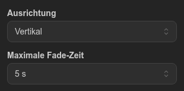

# Globale Fade-Zeit

Das Steuerelement **Globale Fade-Zeit** ist ein Fader, der eine Fade-Zeit für die ganze Konsole festlegt, von **Aus** bis zu einem Maximum zwischen 1 und 30 Sekunden, das Sie wählen. Solange er über **Aus** steht, blendet jede laufende Sequenz in dieser Zeit von Schritt zu Schritt über, und Taster im Modus **Flash** blenden ihre Kanäle ein und aus, statt sofort zu schalten.

## Inhalt

- [Steuerelement hinzufügen und einrichten](#steuerelement-hinzufügen-und-einrichten)
- [Fade-Zeit einstellen](#fade-zeit-einstellen)
- [Was die Fade-Zeit bewirkt](#was-die-fade-zeit-bewirkt)
  - [Sequenzen](#sequenzen)
  - [Flash-Taster](#flash-taster)
- [Beispiel: ein Lauflicht verlangsamen](#beispiel-ein-lauflicht-verlangsamen)
- [Einschränkungen](#einschränkungen)

## Steuerelement hinzufügen und einrichten

1. Öffnen Sie den Tab **Virtuelle Konsole**.
2. Ziehen Sie **Globale Fade-Zeit** aus **Steuerelement hinzufügen** auf die Arbeitsfläche und klicken Sie es an, um es auszuwählen.
3. Wählen Sie die **Ausrichtung**: **Vertikal** oder **Horizontal**.
4. Wählen Sie die **Maximale Fade-Zeit**, also die Fade-Zeit ganz oben am Fader: 1, 2, 5, 10 oder 30 s. Ein neues Steuerelement beginnt mit 5 s. Je kürzer das Maximum, desto mehr Fader-Weg haben Sie für kurze Fades.
5. Um einen Fader oder Drehregler eines MIDI-Controllers zu nutzen, wählen Sie ihn unter **MIDI-Eingang** aus, wie bei einem Schieberegler.
6. Klicken Sie auf **Speichern**.

## Fade-Zeit einstellen

Bewegen Sie den Fader im ausgekoppelten Fenster (Symbol **Auskoppeln** im Panel **Konsole**) oder drehen Sie das zugewiesene MIDI-Bedienelement. Im Editor lässt sich der Fader nicht bewegen. Er zeigt die Fade-Zeit an, die er einstellt:

- Ganz unten zeigt er **Aus**: Nichts blendet, und jede Sequenz behält ihr eigenes Timing.
- Die erste Stufe über **Aus** ist 25 ms, ganz oben steht die **Maximale Fade-Zeit**. Unter 0.10 s zeigt der Fader Millisekunden.
- Die Skala ist logarithmisch, damit sich kurze Fades genau einstellen lassen. Mit 5 s Maximum reicht die untere Hälfte des Faders von 25 ms bis etwa 0.35 s, mit 30 s bis etwa 0.8 s.
  

Alle Steuerelemente vom Typ Globale Fade-Zeit im Projekt stellen dieselbe Fade-Zeit ein, jedes in seinem eigenen Bereich. Das zuletzt bewegte gilt. So können zum Beispiel ein 2-s-Fader für Lauflichter und ein 30-s-Fader für langsame Szenenwechsel nebeneinander liegen. Wenn Sie die **Maximale Fade-Zeit** eines Steuerelements ändern, gilt der neue Bereich ab der nächsten Bewegung seines Faders. Die Fade-Zeit steht nach einem Neustart und beim Wechsel in ein anderes Projekt auf **Aus**. Sie springt außerdem auf **Aus** zurück, wenn Sie ein Steuerelement vom Typ Globale Fade-Zeit löschen.

## Was die Fade-Zeit bewirkt

### Sequenzen

Solange die Fade-Zeit über **Aus** steht, blendet jeder Schritt jeder laufenden Sequenz in der Fade-Zeit ein und blendet nicht aus. Die Fade-Zeit macht einen Schritt nie kürzer, als er in der Sequenz eingestellt ist:

- Ist die Fade-Zeit kürzer als ein Schritt, hält der Schritt für den Rest seiner eigenen Länge. Die Sequenz behält ihr Tempo, und die Fade-Zeit bestimmt nur, wie weich jeder Wechsel ist: wenige Millisekunden sind fast ein harter Schnitt, eine halbe Sekunde ein weicher Übergang.
- Ist die Fade-Zeit länger als ein Schritt, dauert der Schritt so lange wie das Einblenden, die Sequenz wird also langsamer. Ein Fade wird nie abgeschnitten.

Schnelle Lauflichter kommen aus dem Timing der Sequenz oder von einem Beat oder Tap.

Außerdem:

- Das gilt für Sequenzen, die von beliebigen Tastern oder Steuerelementen gestartet wurden. Eine Sequenz, die startet, blendet auch ihren ersten Schritt aus dem Dunkeln ein.
- Wenn Sie den Fader bewegen, beginnt der gerade laufende Schritt sein Einblenden vom aktuellen Bild aus neu, damit das Licht nicht springt. Solange Sie den Fader weiter bewegen, bleibt die Sequenz auf diesem Schritt.
- Ein Schritt, den ein Beat oder ein Tap weiterschaltet, behält die Fade-Zeit, mit der er begonnen hat; eine neue Fade-Zeit gilt ab dem nächsten Beat oder Tap.
- Eine Sequenz, die der **Beat**-Balken eines [Audio-Triggers](audio-trigger.md) oder ein [Globaler Tap](global-tap.md) weiterschaltet, behält das Timing, das dem Beat folgt, wenn **Timing** auf **Dem Beat folgen** steht. Mit **Aus der Sequenz** nutzen ihre Schritte stattdessen die Fade-Zeit.
- Zurück auf **Aus** spielt jede Sequenz wieder mit dem Timing, das in der Sequenz eingestellt ist.

### Flash-Taster

Ein Taster im Modus **Flash**, der Kanäle steuert, blendet beim Drücken in der Fade-Zeit bis zu seiner **Obergrenze** auf und beim Loslassen wieder ab. Lassen Sie ihn los, bevor er die Grenze erreicht hat, blendet er von dort aus ab.

- Der Taster zeigt sich sofort als gedrückt, nur sein Licht blendet.
- Taster im Modus **Umschalten**, Taster, die eine Funktion starten, und Schieberegler ändern sich weiterhin sofort.

## Beispiel: ein Lauflicht verlangsamen

1. Erstellen Sie eine Sequenz, zum Beispiel ein Lauflicht mit vier Schritten, und einen Taster, der es startet.
2. Fügen Sie eine **Globale Fade-Zeit** hinzu und speichern Sie.
3. Öffnen Sie das ausgekoppelte Fenster und starten Sie das Lauflicht. Mit dem Fader auf **Aus** läuft es mit seinem eigenen Timing.
4. Wenn das Lauflicht jede Sekunde einen Schritt macht, schieben Sie den Fader auf etwa 0.5 s: Das Lauflicht behält sein Tempo, und jeder Schritt geht jetzt weich in den nächsten über. Schieben Sie ihn auf etwa 2 s: Die Fades werden länger als die Schritte, das Lauflicht verlangsamt sich auf einen Schritt alle 2 Sekunden.
5. Ziehen Sie den Fader zurück auf **Aus**: Das Lauflicht läuft wieder in seinem eigenen Tempo.

## Einschränkungen

- Eine Sequenz, die stoppt, wird sofort dunkel; die Fade-Zeit blendet sie nicht aus.
- Ist die Fade-Zeit mindestens so lang wie der letzte Schritt einer Sequenz mit **Einmal**, endet die Sequenz, sobald dieser Schritt eingeblendet ist, ihr letztes Bild ist also nur kurz zu sehen.
- Die Fade-Zeit wird nicht gespeichert: Nach jedem Neustart steht sie auf **Aus**.
- Die Fade-Zeit gilt für jede laufende Sequenz. Sie lässt sich nicht auf einige davon beschränken.
