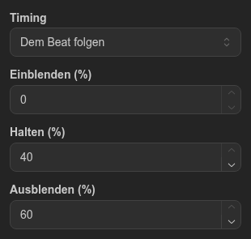
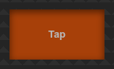

# Globaler Tap

Das Steuerelement **Globaler Tap** ist eine Taste, die Sie im Takt der Musik antippen. Jeder Tap schaltet alle laufenden Sequenzen sofort auf ihren nächsten Schritt, und die Zeit zwischen Ihren Taps legt fest, wie lange jeder Schritt dauert. Wenn Sie aufhören zu tippen, laufen die Sequenzen wieder in ihrem eigenen Tempo.

## Inhalt

- [Steuerelement hinzufügen und einrichten](#steuerelement-hinzufügen-und-einrichten)
- [Tippen](#tippen)
  - [Was ein Tap bewirkt](#was-ein-tap-bewirkt)
  - [Wenn Sie aufhören zu tippen](#wenn-sie-aufhören-zu-tippen)
- [Timing](#timing)
- [Beispiel: ein Lauflicht von Hand steuern](#beispiel-ein-lauflicht-von-hand-steuern)
- [Einschränkungen](#einschränkungen)

## Steuerelement hinzufügen und einrichten

1. Öffnen Sie den Tab **Virtuelle Konsole**.
2. Ziehen Sie **Globaler Tap** aus **Steuerelement hinzufügen** auf die Arbeitsfläche und klicken Sie es an, um es auszuwählen.
3. Wählen Sie das **Timing**, siehe [Timing](#timing).
4. Um auf einem MIDI-Controller zu tippen, wählen Sie sein Pad unter **MIDI-Eingang** aus, wie bei jeder Taste.
5. Klicken Sie auf **Speichern**.

## Tippen

Drücken Sie die Taste im ausgekoppelten Fenster (Symbol **Auskoppeln** im Panel **Konsole**) oder das zugewiesene MIDI-Pad. Im Editor lässt sich die Taste nicht drücken. Sie leuchtet, solange Sie sie halten. Nur das Drücken zählt: Halten oder Loslassen bewirkt nichts.

### Was ein Tap bewirkt

- Jede laufende Sequenz springt auf den Schritt nach dem gerade gespielten und blendet vom aktuellen Bild aus ein. Dabei ist egal, welche Taste oder welches Steuerelement sie gestartet hat.
- Eine Sequenz, die der **Beat**-Balken eines [Audio-Triggers](audio-trigger.md) weiterschaltet, rückt ebenfalls um einen Schritt vor und folgt weiter den Beats.
- **Richtung** und **Ablauf** der Sequenz gelten. Eine Sequenz mit **Einmal** auf ihrem letzten Schritt ignoriert den Tap und spielt diesen Schritt zu Ende.
- Sequenzen, die nicht laufen, werden nicht gestartet.

Alle Globalen Taps im Projekt teilen sich ein Tempo. Sie können also auf dem Bildschirm und auf einem MIDI-Pad gemeinsam tippen.

### Wenn Sie aufhören zu tippen

Nach einem Tap wartet die Sequenz das 1,5-Fache der Zeit zwischen Ihren letzten Taps auf den nächsten Tap. Ein etwas später Tap zählt also noch. Kommt kein Tap, läuft die Sequenz ab dem nächsten Schritt mit dem Timing aus der Sequenz weiter.

Nach einem einzelnen Tap, wenn noch keine Zeit zwischen Taps bekannt ist, spielt die Sequenz den angetippten Schritt mit ihrem eigenen Timing und läuft dann weiter.

## Timing

**Timing** legt fest, wie lange jeder angetippte Schritt dauert:

- **Dem Beat folgen** (Standard für neue Steuerelemente): **Einblenden (%)**, **Halten (%)** und **Ausblenden (%)** jedes Schritts sind ein Anteil der Zeit zwischen Ihren Taps (Standard 0, 40 und 60). Zusammen sind höchstens 100 % möglich. Bei 120 BPM, also 500 ms zwischen den Taps, ergeben die Standardwerte 200 ms Halten und 300 ms Ausblenden.
- **Aus der Sequenz**: Jeder Schritt behält das Einblenden, Halten und Ausblenden aus der Sequenz.

So wird die Zeit zwischen den Taps gemessen:

- Sie ist der mittlere Wert der letzten 4 Abstände zwischen Taps. Ein ungleichmäßiger Tap ändert sie also nicht.
- Der erste Tap und der erste Tap nach einer Pause von mehr als 2 Sekunden verwenden das Timing der Sequenz.
- Ein geändertes Timing gilt nach dem Speichern ab dem nächsten Tap.

## Beispiel: ein Lauflicht von Hand steuern

1. Erstellen Sie eine Sequenz, zum Beispiel ein Lauflicht mit vier Schritten, und eine Taste, die sie startet.
2. Fügen Sie einen **Globalen Tap** mit dem **Timing** **Dem Beat folgen** hinzu und speichern Sie.
3. Öffnen Sie das ausgekoppelte Fenster, starten Sie das Lauflicht mit seiner Taste und tippen Sie zur Musik mit. Das Lauflicht folgt Ihren Taps.
4. Hören Sie auf zu tippen: Das Lauflicht läuft in seinem eigenen Tempo weiter.

## Einschränkungen

- Der Globale Tap schaltet alle laufenden Sequenzen weiter. Er lässt sich nicht auf einzelne beschränken.
- Ein Schritt ohne Einblenden, Halten und Ausblenden hält sein Bild, bis der nächste Tap überfällig ist, statt sofort weiterzugehen.
- Eine Sequenz, die gerade startet, wenn Sie tippen, kann diesen Tap verpassen.
