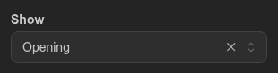

# Show

Das Steuerelement **Show** spielt eine Show aus dem [Show-Manager](../show-manager/show-manager.md) auf der virtuellen Konsole ab, wie ein Audio-Player: Abspielen, Pause, Stopp und eine kleine Zeitleiste mit vergangener, gesamter und verbleibender Zeit.

## Inhalt

- [Steuerelement hinzufügen und einrichten](#steuerelement-hinzufügen-und-einrichten)
- [Abspielen](#abspielen)
- [Einschränkungen](#einschränkungen)

## Steuerelement hinzufügen und einrichten

1. Öffnen Sie den Tab **Virtuelle Konsole**.
2. Ziehen Sie **Show** aus **Steuerelement hinzufügen** auf die Arbeitsfläche und klicken Sie es an, um es auszuwählen.
3. Wählen Sie die Show unter **Show**.
4. Klicken Sie auf **Speichern**.

Ohne Show zeigt das Steuerelement **Keine Show gewählt**.

## Abspielen

Nutzen Sie die Tasten im ausgekoppelten Fenster (das Symbol **Auskoppeln** im Bereich **Konsole**). Im Editor lassen sie sich nicht drücken.

- **Abspielen** startet die Show am Anfang; eine pausierte Show macht dort weiter, wo sie war.
- **Pause** hält Musik und Licht der Show an und behält die Position.
- **Stopp** beendet die Show.
- Die gelben Markierungen auf der Zeitleiste sind die [Cues](../show-manager/show-manager.md#cues) der Show. Zeigen Sie auf eine, um Name und Zeit zu sehen; klicken Sie darauf, um die Show ab dort abzuspielen, auch wenn sie pausiert oder gestoppt ist.

Die Show läuft auf dem Server, daher zeigen alle offenen Konsolen, das ausgekoppelte Fenster und der Show-Manager dieselbe Position. Die Regeln der Wiedergabe stehen auf der Seite [Show-Manager](../show-manager/show-manager.md#show-abspielen).

## Einschränkungen

- Das Show-Steuerelement hat keinen MIDI-Eingang.
- Wird eine Show gelöscht, haben ihre Show-Steuerelemente danach keine Show mehr.
- Nach einem Projekt-Import behält ein Show-Steuerelement seine Show nur, wenn das Projekt diese Show schon hat, denn Shows werden nicht exportiert.
