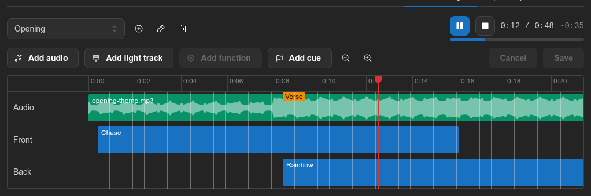
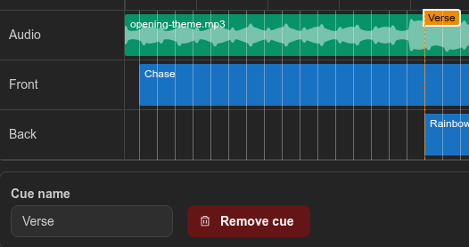
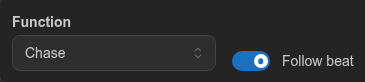

# Show manager

The **Show manager** tab builds timed light shows to music. A show is a timeline with one audio track and any number of light tracks. You place audio files on the audio track and functions on the light tracks. The app finds the beats in the music, draws them as vertical lines and can step your functions on every beat.

## Contents

- [Set up the audio output](#set-up-the-audio-output)
- [Create a show](#create-a-show)
- [Audio track](#audio-track)
  - [Beat lines](#beat-lines)
  - [Cue points](#cue-points)
- [Light tracks](#light-tracks)
  - [Clip settings](#clip-settings)
  - [Overlapping clips](#overlapping-clips)
- [Play a show](#play-a-show)
- [Limitations](#limitations)

## Set up the audio output

The server plays the music, not the browser. Choose where it goes:

1. Open the **Input/Output** tab.
2. Under **Audio output**, tick **Use** next to the sound card or speaker.

A project has one audio output; picking another replaces it. Without an audio output a show still plays its lights, timed by the clock instead of the music.

## Create a show

1. Open the **Show manager** tab and click **New show**.
2. Enter a **Name** and click **Save**.

Switch between shows with the list at the top left. The icons next to it create, rename and delete shows. Deleting a show also deletes its audio.

## Audio track

Click **Add audio** and choose a file. Supported are MP3, WAV, FLAC, Ogg (Vorbis) and Opus files up to 200 MB and one hour long. The server converts the file once and analyses it; a long file can take a few seconds. New audio goes right after the last audio clip.

- Drag an audio clip to move it. Clips on the audio track may touch but not overlap; **Save** refuses overlapping clips.
- Click an audio clip and **Remove audio** to delete it.
- **Add audio** and **Remove audio** only work without unsaved changes: save or cancel first.

### Beat lines

The vertical lines on the timeline are the beats the server found in the audio. It uses the same beat detection as the [Audio triggers](../virtual-console/audio-trigger.md) control: onsets of kick and bass between 40 and 150 Hz. The lines move with their audio clip. The first beat can only be found after 0.3 s of audio, so a kick right at the start of a file has no line.

### Cue points

Cue points mark places in the show you want to jump to, such as the chorus or a drop.

1. Move the red playhead to the place and click **Add cue**. The cue snaps to a beat line close by and is named **Cue 1**, **Cue 2** and so on.
2. Click a cue's yellow flag on the audio track to jump there; while the show plays, it continues from the cue. Drag the flag to move the cue; it snaps to a beat line close by.
3. Change the **Cue name** or click **Remove cue**; the Delete key removes the selected cue too.
4. Click **Save**.

Cues belong to the show, not to an audio clip: moving or removing audio leaves them where they are. They do not change the show's length or what it plays. The [Show](../virtual-console/show-control.md) control shows them on its timeline and as buttons to jump to.

## Light tracks

1. Click **Add light track**. Click a track name to select the track.
2. Click **Add function**: a clip of 8 s with the project's first function appears on the selected track at the red playhead.
3. Drag a clip to move it, also onto another light track, and drag its right edge to make it longer or shorter. Clip edges snap to a beat line close by.
4. Click **Save**.

Click a track name without a clip selected to rename the track (**Track name**) or delete it (**Remove track**). Use the magnifier icons or the mouse wheel over the timeline to zoom it in and out; the wheel keeps the spot under the pointer in place. Hold Shift while turning the wheel to scroll sideways.

### Clip settings

Click a clip to change it:

- **Function**: the function the clip plays.
- **Follow beat** (on for new clips): the function starts dark and takes one step on every beat inside the clip. Off: the function runs from the start of the clip with its own timing.
- **Remove clip**, or the Delete key, deletes the clip.

### Overlapping clips

Clips on different tracks may overlap.

- Clips of different functions play at the same time; where they use the same channel, the highest value wins.
- Clips of the same function share one running function: it runs while any of them is under the playhead and follows the beat if one of them does.
- Two clips of the same function back to back start the function over at the second clip.

## Play a show

Use **Play**, **Pause** and **Stop** at the top right. The times show the elapsed, total and remaining time.

- Drag the red marker, or click or drag anywhere on the time ruler, to move back and forward. While the show plays it jumps there when you let go. While it is paused or stopped, the marker sets where **Play** starts.
- **Pause** stops the music and the show's functions and keeps the position; **Play** continues from there.
- At the end of the show, or on **Stop**, the show's functions stop.
- The server plays the saved show. Unsaved changes play after you click **Save**.
- One show plays at a time. Starting another show stops the current one.
- A function that is already running when its clip begins, for example from a console button, is left to the console: the show neither restarts nor stops it.
- A [Global tap](../virtual-console/global-tap.md) also steps the functions a show is running.

To start a show from the virtual console, use the [Show](../virtual-console/show-control.md) control.

## Limitations

- Shows are not part of project export and import.
- The music and the lights can drift apart by the delay of the sound card; there is no setting to compensate it.
- Audio clips cannot overlap, so they are never mixed.
- Changes to a show that is playing apply the next time it starts.
- The clips on the timeline can only be moved and resized with a mouse or touch, not with the keyboard.
