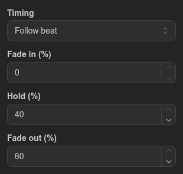
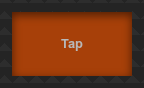

# Global tap

The **Global tap** control is a button you tap in time with the music. Each tap moves every running sequence on to its next step at once, and the time between your taps sets how long each step lasts. When you stop tapping, the sequences go back to their own speed.

## Contents

- [Add and configure the control](#add-and-configure-the-control)
- [Tapping](#tapping)
  - [What a tap does](#what-a-tap-does)
  - [When you stop tapping](#when-you-stop-tapping)
- [Timing](#timing)
- [Example: drive a chase by hand](#example-drive-a-chase-by-hand)
- [Limitations](#limitations)

## Add and configure the control

1. Open the **Virtual Console** tab.
2. Drag **Global tap** from **Add control** onto the canvas, then click it to select it.
3. Choose **Timing**, see [Timing](#timing).
4. To tap on a MIDI controller, choose its pad under **MIDI input**, as for any button.
5. Click **Save**.

## Tapping

Press the button in the pop-out window (the **Pop out** icon in the **Console** panel) or the assigned MIDI pad. The button cannot be pressed in the editor. It lights up while you hold it. Only the press counts: holding the button or releasing it does nothing.

### What a tap does

- Every running sequence jumps to the step after the one it is playing and fades in from the current look. It does not matter which button or control started it.
- A sequence that the **Beat** bar of an [Audio triggers](audio-trigger.md) control steps also moves on by one step and keeps following the beats.
- The sequence's **Direction** and **Run order** apply. A **Single shot** sequence on its last step ignores the tap and plays that step to the end.
- Sequences that are not running are not started.

All Global tap controls in the project share one tempo, so you can tap on the screen and on a MIDI pad together.

### When you stop tapping

After a tap, the sequence waits for the next tap for 1.5 times the time between your last taps, so a slightly late tap still counts. If no tap comes, the sequence carries on from the next step with the timing set in the sequence.

After a single tap, when no time between taps is known yet, the sequence plays the tapped step with its own timing and then carries on.

## Timing

**Timing** decides how long each tapped step lasts:

- **Follow beat** (the default for new controls): each step's **Fade in (%)**, **Hold (%)** and **Fade out (%)** are a share of the time between your taps (default 0, 40 and 60). Together they can be at most 100 %. Tapping at 120 BPM, 500 ms apart, the defaults give a hold of 200 ms and a fade out of 300 ms.
- **From sequence**: each step keeps the fade in, hold and fade out set in the sequence.

How the time between taps is measured:

- It is the middle value of the last 4 gaps between taps, so one uneven tap does not change it.
- The first tap, and the first tap after a pause of more than 2 seconds, uses the sequence's own timing.
- A changed timing applies from the next tap after you save.

## Example: drive a chase by hand

1. Create a sequence, for example a four-step chase, and a button that starts it.
2. Add a **Global tap** with **Timing** set to **Follow beat**, and save.
3. Open the pop-out window, start the chase with its button and tap along with the music. The chase steps with your taps.
4. Stop tapping: the chase runs on at its own speed.

## Limitations

- Global tap moves every running sequence. It has no setting to limit it to some of them.
- A step with no fade in, hold or fade out holds its look until the next tap is overdue instead of passing at once.
- A sequence that is just starting when you tap may miss that tap.
