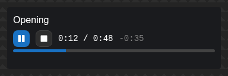
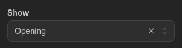

# Show

The **Show** control plays one show from the [Show manager](../show-manager/show-manager.md) on the virtual console, like an audio player: play, pause, stop and a small timeline with the elapsed, total and remaining time.

## Contents

- [Add and configure the control](#add-and-configure-the-control)
- [Playing](#playing)
- [Limitations](#limitations)

## Add and configure the control

1. Open the **Virtual Console** tab.
2. Drag **Show** from **Add control** onto the canvas, then click it to select it.
3. Choose the show under **Show**.
4. Click **Save**.

Without a show the control reads **No show selected**.

## Playing

Use the buttons in the pop-out window (the **Pop out** icon in the **Console** panel). They cannot be pressed in the editor.

- **Play** starts the show at the beginning; on a paused show it continues where it was.
- **Pause** stops the music and the show's lights and keeps the position.
- **Stop** ends the show.

The show plays on the server, so every open console, the pop-out window and the Show manager show the same position. Playback rules are on the [Show manager](../show-manager/show-manager.md#play-a-show) page.

## Limitations

- The Show control has no MIDI input.
- Deleting a show leaves its Show controls without a show.
- After a project import, a Show control keeps its show only when the project already has that show, because shows are not exported.
